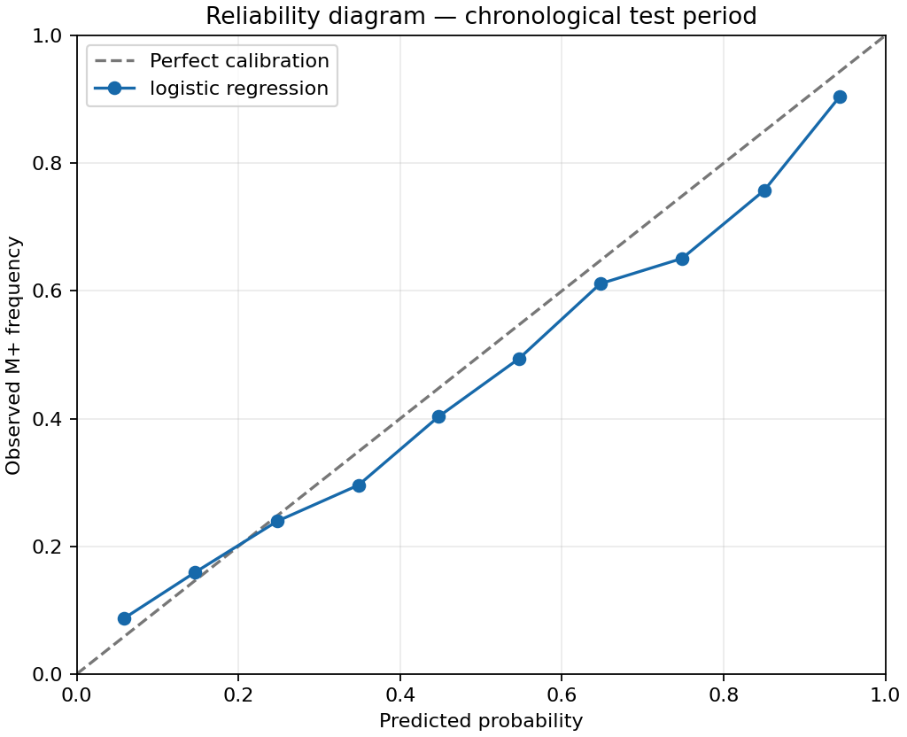

# SolarGuard AI — Phase 2 baseline evaluation

## Method

- Chronological split: 61,248 training rows, 13,107 validation rows, and 13,130 test rows.
- Validation begins **2023-11-16 23:00 UTC**; the held-out test period begins **2025-05-17 12:00 UTC**.
- 24 rows are purged at each split boundary because their 24-hour outcome windows reach or cross into the next period.
- Features use current completed-hour flux plus trailing 6-hour and 24-hour summaries/deltas. No future observations enter features.
- Sigmoid calibration and the threshold maximizing validation TSS are fit using validation data only.
- The training-period M+ prevalence is **11.8%**, while test prevalence is **31.3%**. This temporal prevalence shift reflects a harder test period; it also means a single climatology reference is weak across solar-cycle conditions.

## Held-out test results

| Forecast | Brier score | BSS vs training climatology | TSS | Sensitivity | Specificity | Validation-selected threshold |
|---|---:|---:|---:|---:|---:|---:|
| Training climatology | 0.253 | 0.000 | 0.000 | 0.000 | 1.000 | — |
| Logistic regression | 0.171 | 0.326 | 0.318 | 0.399 | 0.919 | 0.585 |
| Histogram gradient boosting | 0.179 | 0.291 | 0.265 | 0.336 | 0.929 | 0.589 |

Logistic regression is the stronger first baseline on this held-out period. At its validation-selected threshold, it catches 1,639 of 4,107 positive test samples and produces 728 false alarms. The model’s probability ranking is useful relative to the training-climatology reference, but performance remains preliminary and the test prevalence differs sharply from training.

The validation-selected logistic model and sigmoid calibrator are saved at `models/solarguard_logistic.joblib` for the local API. Model selection is based on validation TSS, not the test scores.

## Calibration

The reliability diagram uses the chronological test period. The curve is broadly near the perfect-calibration line, with visible overprediction in several mid-to-high probability bins. Treat the probability and risk bands as experimental until calibration is checked across additional time periods.

Risk bands attached to prediction rows are `<10% Low`, `10–<40% Moderate`, `40–70% High`, and `>70% Severe`.
